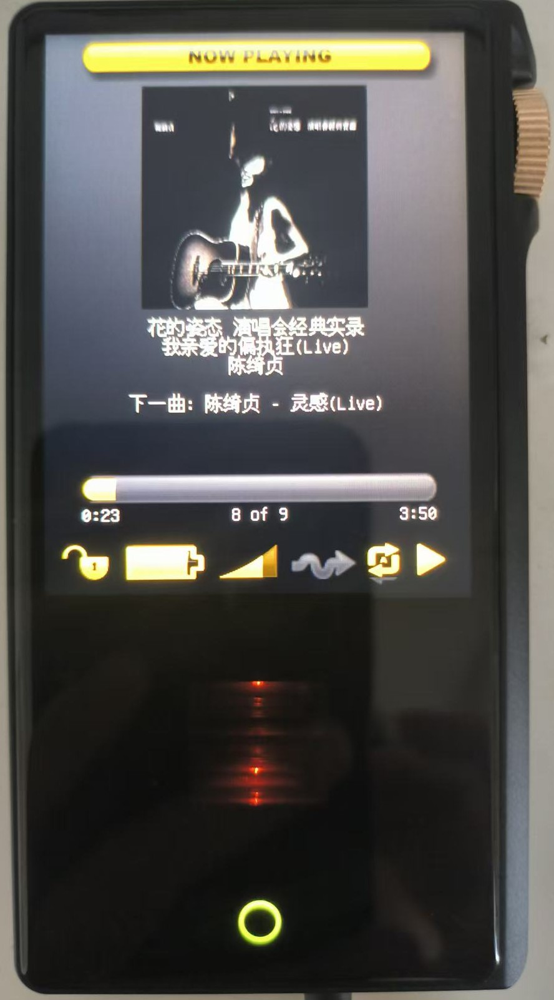
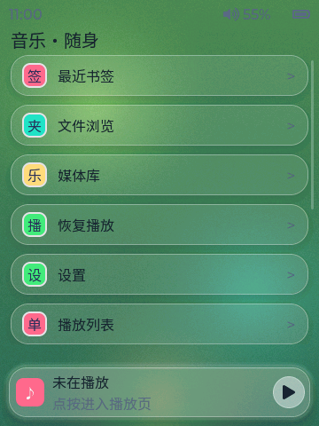
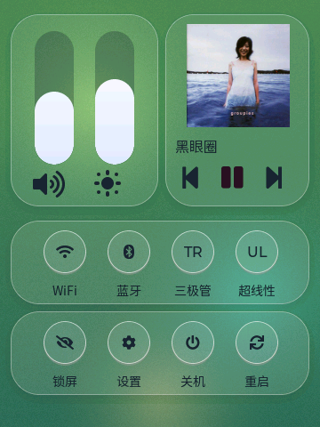

# Rockbox for the Cayin N3Pro

[English](README.md) | **简体中文**

Cayin N3Pro 数字播放器的 **hosted（宿主）** Rockbox 移植（君正 X1000
"MIPS XBurst"，Linux 3.10，HiByOS）。

Rockbox 作为普通 Linux 应用运行在原厂 HiByOS 之上，bootloader、内核和原厂
播放器二进制都不会被修改，因此安装 **完全可逆、不会变砖**。

  

从 [最新 release](https://github.com/ctzjj/Rockbox-N3PRO/releases/latest)
下载现成的刷机镜像和 SD 卡负载。

## 界面截图

原生 LVGL 界面（当前 `main` 线，原 `n3pro-lvgl`）：

  
  
  

  <em>主界面 &middot; 播放界面 &middot; 控制中心</em>

## 特性状态

| 特性 | 状态 |
|---|---|
| 启动（Rockbox 启动菜单 + 回退原厂播放器） | 正常 |
| 屏幕（360x480，32bpp XRGB8888，180° 旋转，扫描束同步无撕裂刷新） | 正常 |
| 按键（电源 / 上一首 / 播放 / 下一首） | 正常 |
| 触摸屏（GT9xx）+ 前下方 HOME 键 | 正常 |
| 音量滚轮（旋转编码器 → 滚轮） | 正常 |
| 音频（双 AK4493，ALSA） | 正常 |
| 耳机 / 线路 / 平衡输出检测 | 正常 |
| DAC 滤波器（5 种）+ 2 只 JAN6418 电子管的电子管模式（晶体管/三极管/超线性） | 正常 |
| SD 卡（`/mnt/sd_0`） | 正常 |
| USB：大容量存储 / 仅充电 / ADB 模式 | 正常 |
| USB 音频（USB DAC，含 "DAC + 存储"、"DAC + ADB" 组合） | 正常* |
| USB DAC **输出**（OTG 口接 USB 声卡：自动切换路由、独立音量） | 正常 |
| 蓝牙输出（A2DP 耳机：扫描 / 配对 / 连接，LDAC/APTX/AAC/SBC） | 正常 |
| 蓝牙输入（手机 A2DP → Rockbox DSP → 有线输出） | 正常 |
| WiFi 菜单（开关、扫描 / 连接 / 已存网络 / 状态） | 正常 |
| 网络电台（WiFi → HTTP/HLS 流，AAC/MP3，自解码） | 正常 |
| DLNA 渲染器（UPnP MediaRenderer，手机/电脑遥控） | 正常 |
| Web 控制（浏览器遥控：HTTP + WebSocket） | 正常 |
| SSH 服务器开关（WiFi 菜单；账号 `root` / 密码 `Rockbox`） | 正常 |
| RGB 状态灯（充电 + 播放，按采样率变色） | 正常 |
| 电池计量 | 正常（内核电量计） |
| 背光 / 休眠 | 正常 |
| 插件（完整插件集：主菜单配置、lrcplayer、游戏、益智等） | 正常 |

\* 在 Windows 上验证；ADB 组合设备里的 adb 接口使用系统自带 WinUSB 驱动，
需要 **libusb** 版 adb 后端（`set ADB_LIBUSB=1`，或使用 Linux/macOS）。

## 硬件说明

* SoC：君正 X1000，Linux 3.10.14，HiByOS。
* 屏幕：360x480 智能 LCD（SLCD）；内核帧缓冲为 **32bpp XRGB8888**、行宽
  1440 字节，面板旋转 180° 安装。Rockbox 内部保持 16bpp RGB565 帧缓冲，
  刷新时转换并旋转，并跟随面板扫描束写入以避免撕裂
  （`firmware/target/hosted/cayin/n3pro/lcd-n3pro.c`）。
* 音频：ALSA card 0（`n3pro-ak4493-i2s`）上的双 AK4493 DAC。数字滤波器对应
  ALSA 的 `AK4493 Digital Filter`（5 种）与 `Digital Filter` 控件。输出级另有
  **两只 JAN6418 微型电子管**；*电子管模式* 决定其工作方式：晶体管（不供电）、
  **三极管**、**超线性**（同一对管子的两种接法）。分两步：先通过 sysfs
  `timbre_select` 给电子管供电，再用 ALSA 控件 `Timbre Tube Mode` 选择接法。
  电子管仅在通过 3.5mm 耳机口播放时供电，暂停 10 秒后关闭；线路输出与 4.4mm
  平衡口始终走晶体管级（与原厂固件一致）。三个接口（耳机/线路/平衡）都有插入
  检测并按需切换 DAC 路由。
* 音量：旋转编码器（`sa-ring-keys`）产生 `KEY_LEFT`/`KEY_RIGHT`，每格是相隔
  数微秒的按下+释放，因此接入 Rockbox 的滚轮机制（`HAVE_SCROLLWHEEL`）。
* 指示灯：TI LP5562 由内核图案引擎驱动（逐通道亮度文件无效）。充电 = 红色
  呼吸，充满 = 红色，播放按采样率变色（44.1/48k 黄，96k 绿，192k 蓝，352k+
  紫，DSD 白）。
* USB：厂商 `android_usb` gadget（非 configfs）。主机 PCM 走厂商字符设备
  `/dev/uac_sa`；启用顺序为 `enable=0 -> functions=... -> enable=1`。纯充电器
  不会枚举，因此用 gadget `state` 区分主机与充电器。
* USB **主机**：主机模式（OTG 转接）下内核 `snd-usb-audio` 把外接声卡注册为
  普通 ALSA 声卡并自动接管（见 *USB DAC 输出*）。该口同一时间只能做主机或
  gadget，不会两者同时。
* 背光：淡入淡出由独立线程以 200Hz 对 `bl_power` 占空驱动。另一条
  `brightness` 路径会通过 LCD 总线发面板命令，每次写入阻塞内核 12–30ms，
  曾导致 DLNA / 蓝牙输入音频在息屏/亮屏时卡顿；稳态路径不变（`bl_power`
  释放驱动的待命占空比）。
* 电池：百分比来自内核电量计
  （`/sys/class/power_supply/battery/capacity`），无需校准；电压/续航曲线使用
  与其他 HiBy 移植一致的锂离子范围。

## 值得关注的设置

* **设置 -> 常规设置 -> 系统 -> USB**
  * *USB 模式*：大容量存储 / 仅充电 / ADB。
  * *USB 音频*：从不 / 始终 / 仅充电时 / 大容量存储时。
    "usb dac" 声卡会与磁盘或 adb 功能同时出现（仅充电连接不会被误判为主机）。
* **设置 -> 常规设置 -> 系统 -> LED 指示**：开启播放指示灯（充电指示始终显示）。
* **设置 -> 声音设置**：*滤波器* 与 *电子管模式*。
* **主菜单 -> WiFi**：电台开关、扫描 / 已存网络 / 状态，以及 **网络电台**、
  **DLNA**、**Web 控制** 和 **SSH** 入口。
* **主菜单 -> 蓝牙**：两个入口 —— **输出（音频输出）** 与 **输入（音频输入）**，
  详见下文。

## 蓝牙

移植通过双入口菜单驱动厂商蓝牙栈（BlueZ4 + `sys_server` + 原厂 ALSA
`bluetooth` 插件，BCM4345C5）：

* **音频输出** —— 连接耳机/音箱（A2DP）：
  * 扫描、配对、连接、断开；按优先级协商对端支持的最佳编码
    （LDAC_HQ → APTX → AAC → SBC）。
  * 输出看门狗跟踪链路状态：耳机（重新）连接时音频自动切到耳机，断开时回落
    到有线接口 —— 切换过程中会暂停播放，避免蓝牙侧音量被带到有线输出。
  * 音量：蓝牙路由使用用户态软音量（`Bluetooth Vol`，50dB 窗口），由正常
    音量键驱动；每路输出各自记忆音量，切换路由时互换。
* **音频输入** —— 手机连到 N3Pro，音乐经 Rockbox 播放：
  * 收到的 A2DP 流由厂商插件解码，经完整 Rockbox DSP 链（**EQ 与声音设置
    生效**）从有线输出播放，采样率跟随链路（44.1/48/88.2/96 kHz）。
  * 进入界面会打开电台（手机可配对）并停止本地播放，与 USB DAC 类似；界面
    显示链路状态、对端、编码与采样率。**返回** 键让其在后台继续接收，
    **断开** 项断开手机并关闭电台。
  * 接收期间有线音量固定在最大 —— **音量由手机控制** —— 结束后（包括接收中
    崩溃或断电）恢复用户自己的音量设置。
* 互斥关系：蓝牙输入会暂停并阻止本地播放（带提示，与 USB DAC 相同），与
  USB DAC 输入、蓝牙输出互斥；电子管对接收音频遵循有线规则，蓝牙输出时强制
  关闭。

## USB DAC 输出

把 **USB 声卡** 插到播放器的 USB-C/OTG 口，播放会自动切到它 —— 无需菜单、
无需设置。切换由内核 uevent 驱动，插拔处理可靠：

* **插入** → 音频切到外接 DAC（任意 `USB-Audio` 声卡；运行时按名称发现，
  无硬编码）
* **拔出** → 音频回到内部输出；未插耳机时暂停播放（模拟输出需要负载），
  插上耳机后继续
* 蓝牙耳机 **优先级更高**；蓝牙断开后如果接着 DAC 则回落到 DAC
* DAC 路由激活期间 **电子管供电关闭**，3.5mm **插入检测挂起**（插拔耳机不会
  打断播放）
* DAC 输出有 **独立音量**（与蓝牙类似），保存在 `config.cfg`；在播放器内以
  数字方式施加（50dB 范围），因此 DAC 自身的硬件音量保持满幅

USB-C 口同一时间只能是主机（USB DAC 输出）或 gadget（ADB / USB 音频输入 /
大容量存储 / 充电）—— 插入 DAC 会接管该口，拔出后恢复正常模式。

## WiFi

WiFi 菜单（基于厂商 `wifi_on.sh` / `wpa_cli` 栈）可开关电台、扫描并连接网络
（记住的 ssid/密码保存在 `config.cfg`）、列出已存网络并显示链路状态。所有
网络功能都挂在其下：

* **网络电台** —— 自带解码器的 HTTP/HLS 流播放（`apps/netfm*`），电台列表来自
  `.rockbox/stream/netfm/netfm.txt`。
* **DLNA 渲染器** —— UPnP MediaRenderer（`apps/dlna/`），由手机/电脑遥控；
  音频走 netfm 管线，因此经过 DSP 链（EQ 与声音设置生效）。
* **Web 控制** —— 小型浏览器遥控（HTTP + WebSocket，`apps/web_control.c`），
  页面在 `.rockbox/web/control/`。
* **SSH** —— 在菜单里启动/停止厂商 `sshd`。用 `root`、密码 **`Rockbox`**
  登录（首次启动时写入 `/etc/shadow`；服务器允许 root 登录）。

## 文件结构

目标驱动在 `firmware/target/hosted/cayin/n3pro/`，包含 **独立的 LCD 与 USB
驱动**（`lcd-n3pro.c`、`usb-n3pro.c` —— 共享的 `lcd-linuxfb.c` /
`usb-hiby.c` 保持上游干净，并在 `firmware/SOURCES` 中为本目标排除）。蓝牙
管理器是 `firmware/target/hosted/cayin/n3pro/n3pro-bluetooth.c`（菜单、配对、
路由、看门狗），接收泵在 `n3pro-bt-input.c`，蓝牙 PCM 钩子在
`n3pro-bt-pcm-hooks.h`。**USB DAC 输出** 路由在 `n3pro-usb-out.c`
（uevent 监听 + 执行），ALSA 后端钩子在 `n3pro-usb-pcm-hooks.h`，接口约定在
`n3pro-usb-pcm.h`。WiFi/SSH 在 `n3pro-wifi.c`（wifi HAL + SSH 开关），
通用层是 `apps/wifi_menu.c` / `firmware/export/wifi_hal.h`。型号头文件是
`firmware/export/config/n3pro.h`，键位表是 `apps/keymaps/keymap-n3pro.c`。
注册位置在 `tools/configure`、`tools/builds.pm`、`firmware/SOURCES`、
`apps/SOURCES`、`apps/bitmaps/native/SOURCES` 和 `apps/lang/english.lang`。
网络电台在 `apps/netfm.{c,h}`（菜单/状态页）、`apps/netfm_stream.{c,h}`
（HTTP/HLS 工作线程 + MPEG-TS 解复用）和 `apps/netfm_playback.{c,h}`（自带
raw-pthread 解码器，接入 `PCM_MIXER_CHAN_NETFM`）；电台从
`stream/netfm/netfm.txt` 读取（每行 `name,url`，随包安装到
`.rockbox/stream/netfm`）。DLNA 渲染器在 `apps/dlna/`（源自 GMediaRender），
浏览器遥控在 `apps/web_control.{c,h}`，页面在 `web/control/`。
`n3pro_port.patch` 把以上全部应用到干净的 Rockbox 检出，`n3pro_patcher.sh`
生成可刷写的 `.upt`。

贡献流程、共享代码守卫规则和完整的硬件逆向笔记见 **[AGENTS.md](AGENTS.md)**。

## 构建

使用共享的 MIPS hosted 工具链（`mipsel-rockbox-linux-gnu`，由
`tools/rockboxdev.sh` 构建），然后：

    export PATH=$HOME/rockbox-toolchain/bin:$PATH

    mkdir build && cd build
    ../tools/configure --target=n3pro --ram=16 --rbdir=/.rockbox --type=N
    make -j
    make fullzip          # SD 卡负载：.rockbox + 字体 + 主题 + 语言

bootloader：

    mkdir build-bl && cd build-bl
    ../tools/configure --target=n3pro --ram=16 --rbdir=/.rockbox --type=B
    make -j

请用 `make fullzip`（而非 `make zip`）：普通 zip 不含字体。

## 打包

`n3pro_patcher.sh` 用原厂升级文件和 bootloader 生成安装镜像：

    firmware/target/hosted/cayin/n3pro/n3pro_patcher.sh stock.upt build-bl/bootloader.n3pro

也支持单独使用 `--unpack`、`--inject-app` 和 `--pack`，需要安装 `7z`、
`genisoimage`、`mtd-utils` 和 `ubireader`。

## 安装

1. 把 microSD 卡格式化为 **exFAT**（或升级器可接受的 FAT32），把
   `rockbox-n3pro.zip` 解压到根目录，根目录会出现 `.rockbox` 目录。
2. 把打补丁后的 `.upt` 文件改名为 **`update.upt`** 并复制到卡根目录。升级器只
   认这个确切文件名。
3. 关机，然后按住 **播放** 键再按 **电源**。升级器（v1.1）会自动刷写并重启。
4. 启动后出现 Rockbox 启动菜单：`ROCKBOX`、`TOOLS` 或 `CAYIN PLAYER`
   （原厂播放器）。`TOOLS` 里还有 *ADB start* 开关和 *Remount SD* 项。

要恢复原厂，重新刷原厂 `.upt` 即可。

如果升级后菜单出现错误标签，用匹配的 `rockbox-n3pro.zip` 整体替换 `.rockbox`
目录 —— 语言文件必须与应用匹配。

## 开发期部署

    adb shell "mount -t vfat /dev/mmcblk0p1 /mnt/sd_0"       # 先挂载！
    adb push rockbox.n3pro /mnt/sd_0/.rockbox/rockbox.n3pro
    adb shell "sync; reboot"

USB 大容量存储 gadget 活动时卡不会被挂载，不先 `mount` 的推送会落到 rootfs 的
影子目录里，等于什么都没改。Windows 上 adb 可能需要 `set ADB_LIBUSB=1`、
`adb kill-server` 并重新插拔。

## 许可证

GPLv2 或更高版本，与 Rockbox 相同。见 Rockbox 树中的 `docs/COPYING`。
